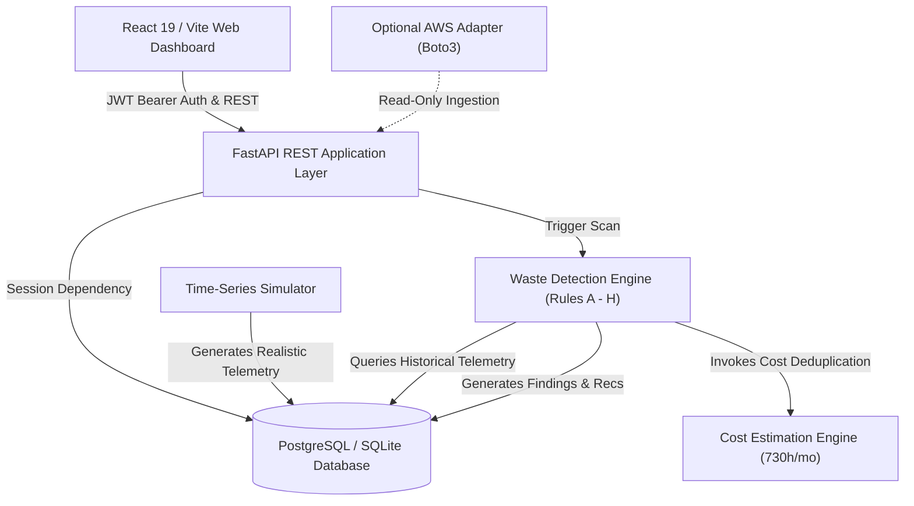
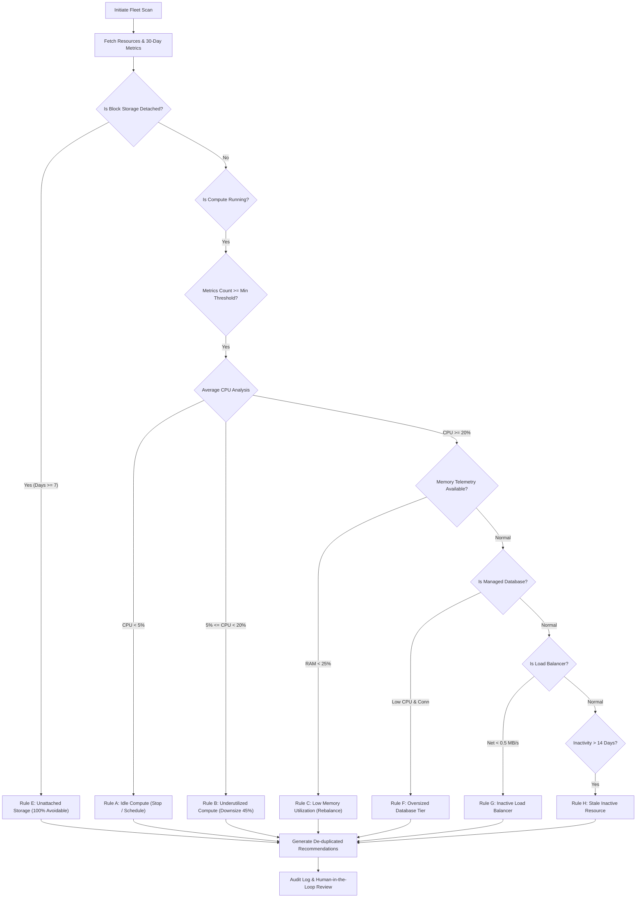

# System Architecture & Technical Specifications
## Smart Cloud Resource Waste Detector (CloudWise)

### 1. High-Level Architectural Overview

The **Smart Cloud Resource Waste Detector** is designed as a decoupled, production-grade microservice architecture comprising:
1. **Frontend Presentation Layer**: Built with React 19, TypeScript, Vite, Tailwind CSS v4, Lucide React, and Recharts. Features a dark-navy glassmorphism UI styled after enterprise cloud operations centers.
2. **Backend Application Layer**: Built with Python FastAPI, Pydantic v2 validation, and SQLAlchemy ORM. Exposes RESTful endpoints, background analysis jobs, structured logging, and an algorithmic waste engine.
3. **Database Persistence Layer**: PostgreSQL for containerized deployments with automatic SQLite zero-setup local fallback.
4. **Cloud Telemetry Ingestion & Simulation**: Dual-mode engine supporting deterministic multi-wave simulation and optional read-only AWS integration via Boto3.

### 2. Multi-Cloud Resource & Waste Engine Flow

The rule-based analysis engine implements 8 enterprise heuristics (Rules A through H):

### 3. Cost Model & Avoidable Savings Formulation

Continuous running resources are calculated on the industry standard of **730 billable hours per month**:
$$\text{Monthly Cost} = \text{Hourly Rate} \times 730$$

Avoidable savings are calculated using strict proportioning:
- **Detached Block Storage**: 100% of volume fee is avoidable.
- **Idle Non-Production Compute**: 100% of instance fee is avoidable if stopped, or 75% if scheduled outside working hours.
- **Underutilized Compute (Downsizing)**: 45% conservative reduction based on standard AWS/GCP instance stepping.
- **Low-Traffic Load Balancers**: 100% baseline fee reduction upon consolidation.
- **Deduplication**: If a resource triggers both Rule A and Rule B, only the higher single avoidable saving is credited to prevent double-counting.
