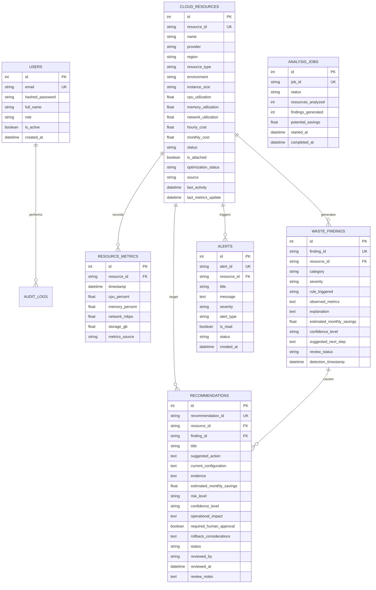

# Database Schema & Entity Relationships
## Smart Cloud Resource Waste Detector

The data layer is modeled using SQLAlchemy 2.0 with foreign keys, cascading deletions, performance indices, and audit logging.

### Cascade & Integrity Guarantees
1. `ondelete="CASCADE"` on `ResourceMetric`, `WasteFinding`, `Recommendation`, and `Alert` ensures that deleting a decommissioned asset thoroughly purges associated telemetry without leaving orphaned foreign keys.
2. Composite index `ix_resource_metrics_res_time` on `(resource_id, timestamp)` accelerates multi-day time-series aggregation queries.
